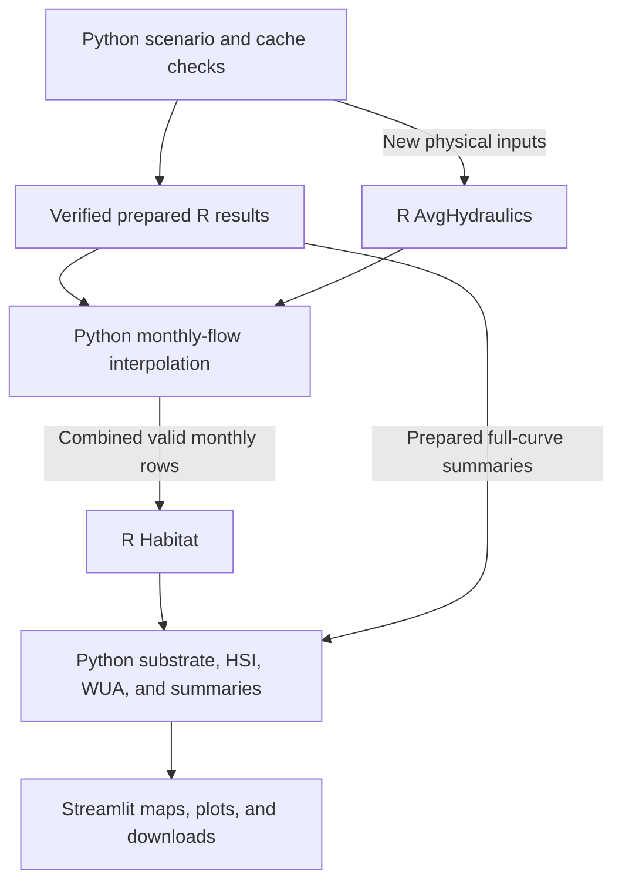

# GIFT Habitat Explorer

A Streamlit app for exploring Geomorphic Instream Flow Tool (GIFT) results across the Upper Grande Ronde stream network. The supplied dataset contains **728 stream segments**, monthly EROM flows, channel-geometry and D84 predictions, temperature suitability, and provisional restoration-priority scores.

**Python manages the app and network workflow. The original R GIFT functions calculate hydraulics and depth/velocity suitability.** Python then applies the network's D84 substrate proxy, calculates HSI and WUA, summarizes results, and renders maps and plots.

The project includes the input data, pinned R source, prepared R calculations, and local setup scripts. Both Python and R are required. The running app has no dependency on ChatGPT.

## Contents

- [Install and run](#install-and-run)
- [Available app options](#available-app-options)
- [How habitat metrics are calculated](#how-habitat-metrics-are-calculated)
- [Backend implementation](#backend-implementation)
- [Inputs and configuration](#inputs-and-configuration)
- [Rebuild prepared results](#rebuild-prepared-results)
- [Deploy on Streamlit Community Cloud](#deploy-on-streamlit-community-cloud)
- [Troubleshooting](#troubleshooting)
- [Verification and attribution](#verification-and-attribution)

## Install and run

Use **Python 3.12**. The local Conda configuration specifies R 4.2 or later and the required packages.

1. Open the project folder containing `app.py` in VSCode.
2. In an Anaconda/Miniconda terminal, create and activate the supplied environment:

   ```powershell
   conda env create -f dev/environment.yml
   conda activate gift_streamlit
   ```

   To add the dependencies to an existing environment instead, activate that environment and run:

   ```powershell
   conda install -c conda-forge "r-base>=4.2" r-dplyr r-zoo r-jsonlite
   python -m pip install -r requirements.txt
   ```

3. From the project root, finish the R setup:

   ```powershell
   Rscript --vanilla setup_r.R
   ```

   The R packages are `dplyr`, `zoo`, `jsonlite`, and `birk`. The repository includes the pure-R `birk` 2.1.2 source package, which does not require Rtools or a compiler. `setup_r.R` installs any missing packages; missing `dplyr`, `zoo`, or `jsonlite` installations require access to CRAN.

4. In VSCode, select the environment through **Python: Select Interpreter**. Run [check_r.py](check_r.py) directly using **Run Python File in Terminal**. It checks the R installation, reports package versions, and executes a real GIFT hydraulic calculation. A successful check reports 981 native stages.
5. Run [run_streamlit.py](run_streamlit.py) directly in VSCode. The launcher starts the app at [http://localhost:8501](http://localhost:8501). Stop it with **Ctrl+C**.

The equivalent terminal launch is `python -m streamlit run app.py`. Use Streamlit or the launcher to run the app; running `app.py` as a plain Python file does not start the web server.

Rscript is discovered from `GIFT_RSCRIPT`, then `RSCRIPT_PATH` in [settings.py](settings.py), then the system PATH and standard Windows R installation folders. Leave `RSCRIPT_PATH = None` when using R from an activated Conda environment. An explicit Windows installation can also be selected, for example:

```python
RSCRIPT_PATH = r"C:\Program Files\R\R-4.5.2\bin\Rscript.exe"
```

Use the path to the version actually installed on your computer.

## Available app options

### Network and map controls

The controls above the map affect the entire network, including the map, selected-segment inspector, comparison plots, and network export.

| Control | Options and behavior |
| --- | --- |
| **Network Layer** | **GIFT habitat**, **Temperature Suitability**, or **Provisional Priority**. Temperature and priority are supplied scores and remain unchanged when habitat curves or months change. |
| **Bankfull width regression** | **CHaMP Regression**, **Bieger 2015 National**, **Bieger 2015 Regional**, or **Castro and Jackson 2001**. Default: **CHaMP Regression**. |
| **Bankfull depth regression** | The same four choices, selected independently of width. Default: **Castro and Jackson 2001**. Depth means reach-averaged bankfull depth. |
| **Habitat metric** | **HSI** or **WUA** buttons. Default: **HSI**. |
| **Map mean HSI / Map mean WUA** | Off: habitat at the selected monthly flows, summarized by their median. On: the average of each segment's full modeled response curve over discharge. The label follows the habitat metric. |
| **Basemap** | **Light**, **Dark**, or **Satellite**. Basemap tiles require internet access. |
| **Fit network / Zoom to segment** | Map controls that fit the complete network or locate the selected segment. |

Click a stream segment to inspect it. Clicking a comparison-plot point also selects and locates that segment. Gold identifies the selected segment; gray indicates an unavailable map value. Color scales use the active layer's observed maximum, so their numerical limits can change between scenarios.

Bieger Regional uses the division configured by `BIEGER_REGION` in `settings.py`, initially **Intermontane Plateau**. Castro and Jackson uses the **Western Cordillera** drainage-area relationships. CHaMP uses the predictions already supplied in the input data; the app does not refit those regressions. Equation and unit details are in [HYDRAULIC_OPTIONS.md](HYDRAULIC_OPTIONS.md).

### Suitability curves and assessment period

The sidebar selects the suitability curves and monthly assessment period.

| Curve set | Initial assessment period |
| --- | --- |
| Chinook juvenile rearing | July–September |
| **Chinook - Spawning** | August–September |
| Steelhead juvenile rearing | July–September |
| Steelhead spawning | March–June |
| **General salmonid** | July–September |
| **GIFT Shiny Default** | July–September |

**Chinook - Spawning** uses only the supplied stream/river curves. The large-river curve set is excluded from the active options. GIFT Shiny Default uses the supplied graph-derived CSVs without smoothing or rescaling; their provenance is documented in [SHINY_DEFAULT_SOURCE.md](inputs/curves/SHINY_DEFAULT_SOURCE.md).

These periods are editable study defaults. They do not define universal occupancy windows. **Restore life-stage default** restores the active curve set's period. **View Suitability Curves** opens the depth, velocity, and substrate curves.

| Sidebar control | Behavior |
| --- | --- |
| **Single month** | Evaluate each segment at its own EROM discharge for that month. |
| **Month range** | Include both endpoints; ranges can cross December. |
| **Require every selected month** | Checked by default. Withhold the period's habitat result if any selected month is unsupported. Unchecking permits medians of available months and retains partial-coverage information. |
| **Flow units** | Display discharge in **cfs** or **m³/s**. Calculations and CSV downloads use SI units. |

Mean-map mode disables the monthly period controls. It also removes monthly inspector values, flow markers, and flow-range shading from the response plots.

### Custom suitability curves

Expand **Use your own suitability curves**, name the curve set, upload all three CSVs, and select **Apply uploaded curves**.

| CSV | Required columns | Units |
| --- | --- | --- |
| Depth | `depth,suit` | Depth in m; suitability from 0 to 1 |
| Velocity | `velocity,suit` | Velocity in m/s; suitability from 0 to 1 |
| Substrate | `lower,upper,suit` | Class bounds in mm; suitability from 0 to 1 |

**Download current CSV examples** provides the selected curves in the required format. Depth and velocity need at least two distinct coordinates. Non-finite or negative coordinates, duplicate depth/velocity coordinates, invalid suitability values, and overlapping substrate classes are rejected. Each file is limited to 5 MB and 10,000 rows.

Substrate gaps are allowed. A segment whose D84 falls outside the supplied classes has unavailable HSI/WUA. Classes include their lower bound and exclude their upper bound.

Custom curves initially inherit the previous selection's assessment period. Adjust the months for the intended application. Uploads and selections are held in the user's session; computed results may also enter bounded server caches. They are not written into the repository's curve files.

### Selected-segment results and hydraulic edits

The inspector reports the active **network scenario**: raw depth, velocity, D84, component suitability, HSI, WUA, temperature, and priority. In monthly mode, **Inspect month** chooses a single month for the raw values; the period summary is shown separately. **Network hydraulic input values** exposes the physical inputs.

Below the map, **Habitat response to flow** contains **WUA**, **HSI**, and **Channel Geometry** tabs, selected independently of the map and comparison metrics. Depth and velocity suitability use the secondary axis on the response plots. The cross section is GIFT's assumed geometry, with an exaggerated vertical axis.

**Adjust selected-segment hydraulics** provides editable bankfull width, mean bankfull depth, slope, D84, and an optional maximum bankfull depth. These edits affect only that segment's response plots, geometry plot, and selected-segment downloads. The map, network inspector, comparison plots, and network export retain the selected network regressions.

Edits persist by segment within the session. Unedited fields follow the active network scenario. **Restore segment defaults** clears that segment's edits.

Maximum bankfull depth starts blank:

- Unchanged CHaMP width and depth use the source maximum-depth prediction.
- Alternative or edited width/depth uses GIFT's width-to-mean-depth shape estimate.
- An entered maximum overrides the automatic behavior for the plot and must be at least the mean bankfull depth.

Monthly plots show separately evaluated monthly points and a selected-flow envelope. Mean mode shows a gold diamond at the modeled discharge-range midpoint. Its height represents the curve average, which can differ from the curve value at that midpoint.

### Comparison plots and downloads

The comparison panel offers habitat versus **Temperature suitability**, **Provisional Model priority**, **Depth suitability**, **Velocity suitability**, and **Substrate suitability**. Each point represents one segment with both values available.

Its **Plot WUA** switch is independent of the map metric: off plots HSI; on plots WUA. Comparisons follow the current monthly-period or full-curve-mean mode. Relationships with component suitability are partly defined by the HSI equation and should be interpreted accordingly.

| Download | Contents |
| --- | --- |
| **Network period/mean summary** | One row per segment, habitat metrics, component scores, coverage, active regression sources, and source provenance. |
| **Monthly results for this segment** | Exact selected monthly flows and results using the active plot inputs; available in monthly mode. |
| **Full flow-response curve** | The selected segment's native modeled response using its active plot inputs. |
| **GIFT inputs and diagnostics** | JSON containing physical inputs, flow bounds, active curves, availability reasons, and provenance when monthly results are unavailable. |
| **Current CSV examples** | A ZIP containing the three active suitability tables. |

CSV downloads retain SI units regardless of the display units and identify the original R engine and pinned GIFT revision. Diagnostics appear under **GIFT inputs and unavailable-result diagnostics**. Source mappings and coverage are available in the app's input notes.

## How habitat metrics are calculated

For segment `r` at discharge `Q`, the original R `Habitat()` function returns distribution-weighted depth and velocity suitability. The app calculates:

```text
HSI(r, Q) = depth_suitability(r, Q)
          × velocity_suitability(r, Q)
          × substrate_suitability(r)

WUA(r, Q) = HSI(r, Q) × wetted_width(r, Q)
```

HSI is dimensionless. WUA is **m² of usable habitat per metre of reach**, numerically equivalent to a suitability-weighted width. The app reports reach-level values. A total usable area would require multiplying each segment's WUA by its length before summing.

### Hydraulics and substrate

`AvgHydraulics()` constructs a representative cross section from bankfull dimensions, uses slope and D84 in the Ferguson resistance relationship, and calculates area, wetted width, mean depth, mean velocity, and discharge across water levels. A normal run contains 981 native water levels; invalid stages are filtered.

The shape factor is `1 - mean depth / maximum depth` when maximum depth is supplied, otherwise `(bankfull width / mean depth) / 100`. Shape factors must be in `[0, 1)`. Values above 0.7 are retained without capping and flagged; the original R function identifies that range as potentially unrealistic.

At each supported monthly discharge, Python interpolates the native mean depth, velocity, and width. R then evaluates **121-bin within-reach depth and velocity distributions**, using nearest-coordinate lookup on the suitability curves. The component scores therefore incorporate modeled distributions rather than just the suitability of the reach-mean depth or velocity.

For the supplied network, Python assigns substrate suitability from the class containing predicted D84. **D84 affects both hydraulic resistance and substrate suitability.** This application uses one grain-size proxy. Although the R interface supports a grain-size distribution, the network inputs do not supply one.

### Monthly summaries and full-curve means

Monthly mode calculates habitat separately at every month's exact EROM flow, then takes the median of the selected monthly HSI and WUA results. It does not calculate habitat at median discharge or multiply separately summarized component scores.

Mean-map mode calculates each metric `M` as:

$$
\overline{M}_r = \frac{1}{Q_{\max,r}-Q_{\min,r}}
\int_{Q_{\min,r}}^{Q_{\max,r}} M_r(Q)\,dQ
$$

The implementation uses **201 equally spaced discharges** and trapezoidal integration. Each segment uses its own modeled discharge bounds. This is a discharge-range average, not a time average or a flow-duration-weighted estimate. Mean HSI and mean WUA are integrated separately.

Positive flows below the modeled minimum or above modeled bankfull remain unavailable. Supported zero-flow months have zero HSI and WUA, with undefined depth and velocity suitability. Missing inputs, missing flows, and unclassified substrate retain explicit availability statuses.

## Backend implementation

### Python calls the original R code

[r_engine.py](r_engine.py) uses Python's `subprocess` module to launch **one persistent Rscript worker per Python process**. It does **not use `rpy2`**. Requests and responses are JSON messages sent through standard input and output; R diagnostic messages are read separately from standard error.

The worker loads bundled copies of `AvgHydraulics.R` and `Habitat.R` from [the original GIFT repository](https://github.com/SGronsdahl/GIFT), pinned to commit `40c4a74f82d842cd2ab8ab4c53e2b985ac4e0030`. SHA-256 checks verify those files and the bundled `birk` archive against [provenance.json](r_gift/provenance.json). The app does not fetch GIFT from GitHub during operation.

The original hydraulic function normally returns a resampled discharge table. [worker.R](r_gift/worker.R) changes only the final return expression of an **in-memory copy** to expose the native stages, shape factor, and cross-section grid already computed inside the function. The bundled original source and its numerical statements remain unchanged. R plot-file output is disabled; Python renders the app figures.



Both R functions run in the same worker. Selected-segment response curves and newly calculated full-curve means also call `Habitat()` through that worker.

### Individual calls, batches, and file ownership

| Operation | Request sent to R | Python's responsibility |
| --- | --- | --- |
| Native hydraulic curve | One segment's physical parameters per request to `AvgHydraulics()`. | Loop through segments when a network rebuild is needed; retain each segment's curve. |
| Monthly network habitat | One combined hydraulic table containing all valid segment-month rows across all twelve months, evaluated by `Habitat()`. | Retain COMID/month keys, reattach returned rows in order, apply per-segment substrate scores, and summarize the selected months. |
| Selected-segment response | A table of native hydraulic stages for one segment. | Combine component scores and prepare plots and CSVs. |
| New full-curve mean | A table of 201 discharge states per segment. | Interpolate physical values and integrate each response over discharge. |
| Saved network assets | R returns numeric results as JSON messages. | Write the persistent JSON summaries and compressed NumPy hydraulic arrays during offline preparation. |

**The R worker returns results to Python; Python writes the network result files.** Normal app interactions use prepared assets and memory caches without rewriting those files.

Network scale means applying the reach model across the network. Segments use their own physical attributes and monthly flows. Hydraulic effects are not routed between upstream and downstream segments.

### Prepared results, caching, and concurrency

[data/r_scenarios](data/r_scenarios) contains verified original-R calculations for:

- CHaMP width with CHaMP mean depth.
- CHaMP width with Castro and Jackson mean depth, the app default.

These include native hydraulic curves, monthly hydraulic values, and full-curve means for the supplied suitability sets. Prepared assets are reused only when their relevant source fingerprints, calculation-code hashes, reach IDs, regression choices, region, curve definitions, and file checksums match. A custom curve can reuse compatible hydraulics while requiring new habitat calculations.

A selected segment's detailed response is calculated through R when first needed and cached. Separate bounded caches retain physical curves, habitat results, summaries, comparison figures, and exports. Changing species or months can reuse the physical solution; editing width, depth, slope, or D84 requires a different solution. Server restarts clear memory caches. Prepared files remain available.

A lock serializes requests shared by Streamlit sessions within one Python process. Request IDs, a timeout, pipe readers, and worker restart handling protect the request/response sequence. `GIFT_R_TIMEOUT` sets the timeout in seconds, initially 300. An uncached network scenario can take several minutes because its hydraulic requests run sequentially in the app process.

R is checked at startup even when prepared results are available. Missing R or required packages produce an explicit setup error. The Python implementation under `model/` remains for independent regression checks and legacy batch tools; the Streamlit calculation path has no Python fallback.

### Main files

| File or directory | Role |
| --- | --- |
| [app.py](app.py) | Streamlit entry point, controls, session state, and application caches. |
| [settings.py](settings.py) | Source paths, layers, field mappings, units, defaults, region, and Rscript configuration. |
| [r_engine.py](r_engine.py), [r_gift/worker.R](r_gift/worker.R) | Python/R bridge and persistent R worker. |
| [r_gift/upstream](r_gift/upstream) | Pinned original GIFT functions. |
| [habitat_engine.py](habitat_engine.py) | Monthly interpolation workflow, habitat calls, D84 scores, period summaries, diagnostics, and exports. |
| [bankfull_regressions.py](bankfull_regressions.py), [network_scenarios.py](network_scenarios.py) | Geometry scenarios, network solutions, and full-curve means. |
| [runtime_data.py](runtime_data.py), [r_scenarios.py](r_scenarios.py) | Source checks and verified prepared-result loading. |
| [presentation.py](presentation.py) | Maps, legends, cross sections, and charts. |
| [prepare_r_scenarios.py](prepare_r_scenarios.py) | Offline calculation and publication of reusable R results. |

## Inputs and configuration

All active sources, fields, and units are configured in [settings.py](settings.py). Paths are anchored to the project folder.

| Input | Supplied source or field |
| --- | --- |
| Stream network and monthly flows | `inputs/UGR_channel_geometry_predictions_monthly_EROM.gpkg`, layer `channel_geometry_predictions`. |
| CHaMP bankfull dimensions | `bf_width_pred_m` and `bf_depth_pred_m`. |
| Maximum bankfull depth | `bf_depth_max_pred_m`, joined by COMID. |
| Slope, D84, and drainage area | `SLOPE`, `D84_pred`, and `TotDASqKm`. |
| Temperature and priority | `inputs/Provisional_Model_Layer.gpkg`, layer `provisional_model_layer`, joined by COMID. |
| Temperature / priority columns | `currTempScoreKSee` / `High priority combined`; category `FinalScore_cat`. |
| Suitability tables | `inputs/curves/`. |

EROM flows are gage-adjusted **1971–2000 monthly climatological means**. They represent the supplied historical flow dataset, including its limitations regarding diversions, rather than current observations or a daily hydrograph.

Temperature and priority are displayed unchanged and are separate from GIFT. The temperature score uses the supplied juvenile-salmon interpretation associated with [See et al. (2021)](https://doi.org/10.1002/ecs2.3404); its transformation was not reconstructed in this app. It should not be interpreted as a life-stage-specific spawning temperature model.

To change an input, edit its source mapping and matching units together. Width/depth accept `m` or `ft`; D84 accepts `mm`, `m`, or `in`; slope accepts `m/m`, `ft/ft`, or `percent`; drainage area accepts `km2` or `mi2`; discharge accepts `m3/s` or `cfs`. Inputs are converted to SI before calculation. Display simplification, initially 8 m, affects map geometry only.

Full app reruns check current sources, mappings, units, curves, and calculation code. Changed attributes are refreshed. In the CHaMP/CHaMP overview path, segments without matching prepared monthly hydraulics await calculation when selected; their results then update the session's map and export. An unprepared regression scenario or full-curve mean can require network-wide calculation. Rebuild prepared results before publishing changed inputs to avoid that work during app use.

## Rebuild prepared results

Run [prepare_r_scenarios.py](prepare_r_scenarios.py) directly in VSCode using the configured Python/R environment. No preparation run is needed for the bundled inputs.

The script reads current configured sources, calculates both bundled geometry scenarios, and writes the network JSON, native hydraulic arrays, full-curve means, and provenance. It normally uses up to four Python processes, each with its own persistent R worker. Each task handles one segment/scenario combination.

`WORKERS` and `PREPARE_MEAN_SUMMARIES` are editable near the top of the script. `GIFT_PREPARE_WORKERS` overrides the worker count. Completed reach calculations are checkpointed under `data/r_build_cache/` so interrupted builds can resume. This cache is excluded from deployment packages.

The older [prepare_data.py](prepare_data.py) entry point can rebuild the source overview through R and produces legacy native `.bin` files. The web app does not require those files. Use `prepare_r_scenarios.py` to refresh both reusable scenarios and mean summaries.

## Deploy on Streamlit Community Cloud

Deploy the complete repository with these settings:

| Setting | Value |
| --- | --- |
| Main file path | **`app.py`**, or its repository-relative path if nested. |
| Python version | **3.12**, selected under **Advanced settings**. |
| Python dependencies | Root `requirements.txt`, retaining the pinned versions. |
| System dependencies | `packages.txt` at the **GitHub repository root**. |

`packages.txt` installs `r-base-core`, `r-cran-dplyr`, `r-cran-zoo`, and `r-cran-jsonlite`. The worker installs the bundled pure-R `birk` archive into a user cache if that package is missing. Include `r_gift/`, `inputs/`, `data/`, and the application modules in the deployment.

Keep the local Conda file under `dev/environment.yml`. Remove a legacy root `environment.yml` if upgrading an older copy: Community Cloud prioritizes that file ahead of `requirements.txt`. Also retain `packages.txt` at the repository root when `app.py` is nested.

[Streamlit deployment settings](https://docs.streamlit.io/deploy/streamlit-community-cloud/deploy-your-app/deploy) and [dependency-file handling](https://docs.streamlit.io/deploy/streamlit-community-cloud/deploy-your-app/app-dependencies) are documented by Streamlit. The included Dockerfile provides another deployment configuration using Python 3.12 and system R packages. [run_streamlit.py](run_streamlit.py) is the local launcher; `app.py` is the deployment entry point.

## Troubleshooting

| Symptom | Check or action |
| --- | --- |
| **Rscript was not found** | Activate the correct environment and run `Rscript --version`. Check `GIFT_RSCRIPT` and `RSCRIPT_PATH` if discovery fails. |
| Missing R package | Run `setup_r.R` through the same R installation, then rerun `check_r.py`. |
| Original-source checksum mismatch | Restore the pinned R files, bundled dependency, and provenance together. The source checks are intentional. |
| Gray segment or unavailable HSI/WUA | Open the availability diagnostics. Check physical inputs, modeled flow bounds, monthly flow, substrate classification, and period coverage. |
| Period result missing despite some valid months | Review **Require every selected month** and the valid-month counts. |
| First alternative scenario or custom mean is slow | The scenario may require a complete R calculation. Prepare the results offline when appropriate. |
| Plot edits differ from the map or inspector | Plot edits affect selected-segment plots and downloads. Network controls determine map and inspector results. |
| Basemap missing while stream results remain available | Check the internet connection and basemap provider. |
| App runs with old Python packages | Confirm the VSCode interpreter and installed `requirements.txt` versions; restart the server after updating. |

## Verification and attribution

Run [run_checks.py](run_checks.py) directly in VSCode with R and `pytest` available. Checks cover frozen original-R references, live R calculations, prepared-result consistency, source invalidation, worker behavior, app controls, and exports. [VALIDATION.md](VALIDATION.md) records completed checks and their limits, including the runtime versions tested.

GIFT was developed by Stefan Gronsdahl. This application uses the original functions at the pinned revision above and adds network data handling, scenario controls, the D84 substrate proxy, aggregation, and visualization. See [NOTICE.md](NOTICE.md) and [LICENSE](LICENSE) for attribution and GPL-3.0 licensing. Additional implementation details are in [R_BACKEND.md](R_BACKEND.md).
